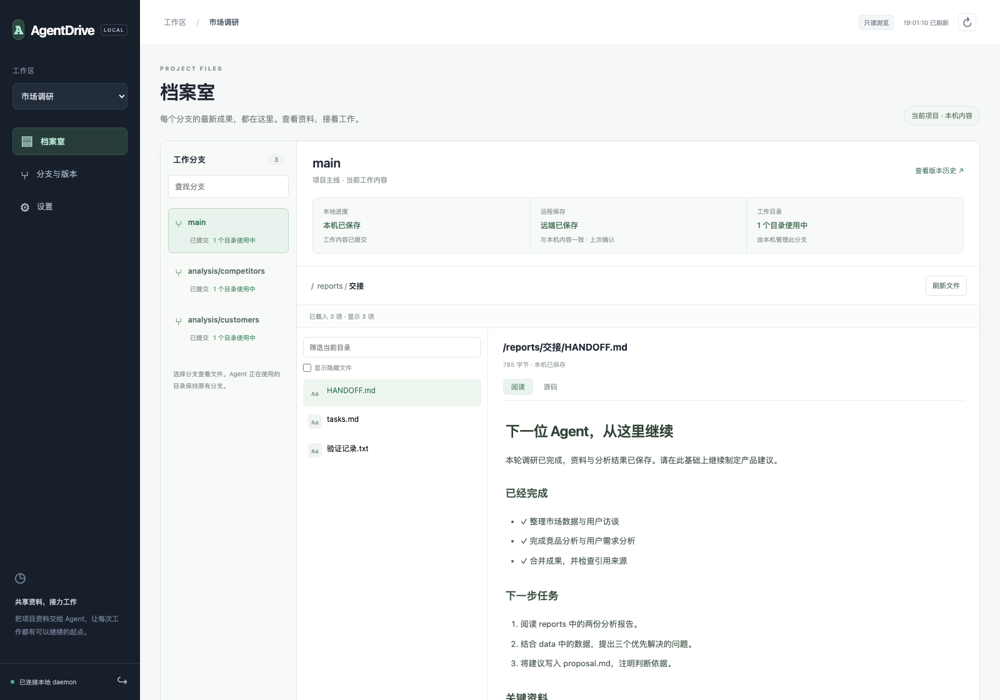
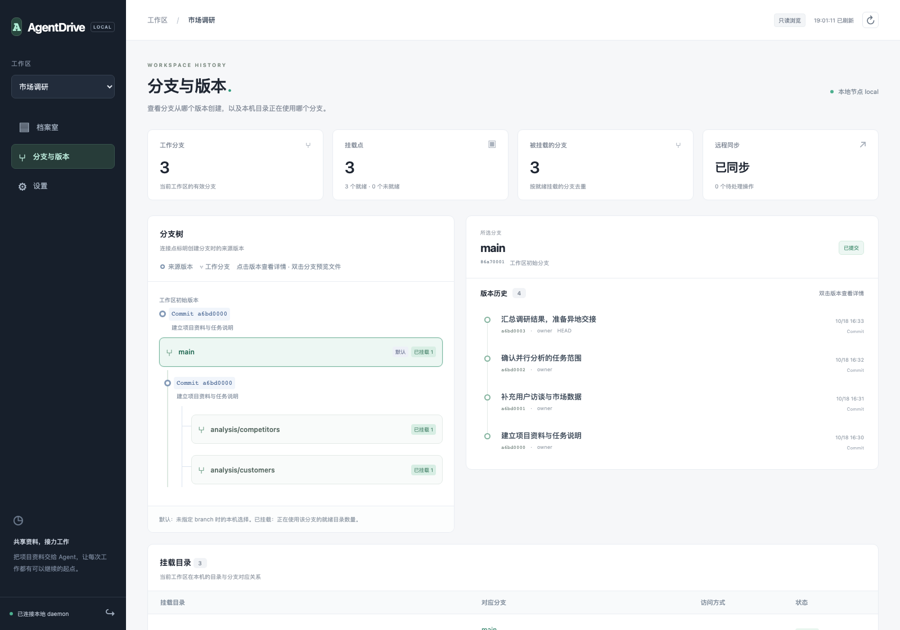

# AgentDrive

[English](README.md) | [简体中文](README.zh-CN.md)

**共享资料，接力工作。**

AgentDrive 给人和 Agent 一个可以持续使用的项目空间。Agent 在本地目录中读取资料、生成文档和修改代码；工作成果可以保存到远端，让另一台机器上的 Agent 接着完成任务。分支保留不同任务的工作内容，版本记录每次成果的变化。

你可以继续使用熟悉的 Agent、编辑器和终端，通过 MCP 让 Agent 管理资料的保存、同步、分支与交接。人在浏览器的 **档案室** 中直接查看各个分支的最新文件。

> 当前为开发预览，尚未发布首个正式版本。产品名称暂为 AgentDrive。



*演示项目：市场调研。在 `/reports/交接` 中阅读 Agent 交接说明，查看本地保存与远端确认状态。*

## 围绕项目持续工作

| 使用场景 | AgentDrive 帮你完成的事情 |
| --- | --- |
| 本地工作，远程保存 | Agent 像使用普通目录一样工作，成果保存在本机，并通过配置的 S3 / RustFS 同步到远端。 |
| 异地 Agent 接手 | 把任务说明、输入资料、阶段成果与下一步一起保存；目标机器拉取后继续处理。 |
| 多个 Agent 并行尝试 | 从同一份资料创建分支，各自完成分析或实现，检查差异后合并成果。 |
| 人随时检查进展 | 在档案室选择项目和分支，直接阅读文件；进入分支与版本查看来源、历史和修改内容。 |

## 使用方式

### 1. 在本地接入项目，让 Agent 开始工作

按照[安装与启动](docs/installation.zh-CN.md)运行 AgentDrive，并将它连接到支持 MCP 的 Agent 客户端。已有本地目录可以导入工作区并继续使用原路径；转换目录前暂停写入，转换完成后重启 Agent。

可以直接告诉 Agent：

> 将这个项目接入 AgentDrive。保留原目录中的资料，为本次任务创建一个工作分支，并告诉我工作目录和分支名称。

Agent 通过 MCP 创建、挂载或转换工作区，随后继续使用普通文件工具读写目录。文件修改会自动保存；需要明确记录一个阶段时，让 Agent 保存版本，并填写这次完成了什么。

### 2. 将本地成果同步到远端

在 Dashboard 的 **设置** 中连接 S3 或 RustFS，填写 Endpoint、Bucket 和凭据。多台机器使用相同的 Bucket、Prefix 与项目访问身份，各自保留独立的本地配置和数据目录。[连接说明](docs/configuration.zh-CN.md)

> 将当前分支的成果保存到远端。确认远端保存成功后，告诉我 workspace ID、分支、版本以及交接说明的位置。

Agent 可以通过 `mount_save` 请求远端保存，并通过操作结果检查 `remote_confirmed`。等待超时后继续查询同一个操作，直到得到确认。**本机已保存与远端已保存分别展示**；档案室中的远端状态来自最近一次确认。

### 3. 让另一台机器上的 Agent 接着工作

在项目中保留一份 `HANDOFF.md`，写明任务目标、已完成事项、关键文件、验证方式和下一步。将这份说明与成果一起保存到远端。

将 workspace ID、源分支或版本、交接说明路径交给目标 Agent：

> 拉取这个项目最新确认的远端资料，读取 HANDOFF.md，从指定分支的成果创建我的工作分支，挂载到本机目录，再继续下一步任务。

目标 Agent 使用 `sync` 拉取，再从指定来源创建分支并挂载。若要继续写入**同一个分支**，原机器需要停止写入并释放挂载，通过 `ownership_transfer` 将写入权限交给目标 location；目标机器拉取确认后再接手。[交接与恢复步骤](docs/operations.zh-CN.md)

交接材料包括文件、版本和分支信息。Agent 的任务说明可以作为文件一起传递；运行中的进程、聊天记录和客户端凭据由各自的 Agent 客户端管理。

### 4. 在档案室查看成果，在版本历史中检查变化

打开 Dashboard，选择项目，进入 **档案室**：

- 单击分支即可查看当前目录，右侧自动展示文件内容。
- Markdown 支持阅读和源码两种视图；文本可以分段阅读，二进制内容显示十六进制。
- 目录以 `/a/b/c` 展示，点击任一级即可跳转；支持筛选当前目录和显示隐藏文件，复制地址后可回到相同的项目、分支和目录。
- 本地进度、远端确认与目录使用情况分别展示。浏览分支时，Agent 使用的挂载目录保持原来的分支。
- 文件范围是本机已知的当前内容，包含未保存或未提交修改；查看其他机器的新成果前，让 Agent 拉取远端更新。



*同一个演示项目的分支与版本页面。双击版本可以查看说明、修改文件和文本差异。*

## 方便 Agent 操控

在支持 stdio MCP 的客户端中添加下面的配置，将示例路径替换为本机绝对路径：

```json
{
  "mcpServers": {
    "agentdrive": {
      "command": "/absolute/path/agentdrive/target/debug/agentdrive",
      "args": ["mcp"],
      "env": {
        "AGENTDRIVE_TOKEN_FILE": "/absolute/path/to/agentdrive/token"
      }
    }
  }
}
```

保持 AgentDrive 服务运行。Agent 可以查询工具说明，再完成创建工作区、分支、保存、同步与交接。支持 Streamable HTTP 的客户端也可以连接 `http://127.0.0.1:7421/mcp`，使用本机 token 认证；CLI 适合终端操作和脚本，ACP / Codex app-server 可连接工作目录与任务结束保存。[Agent 集成](docs/integrations.zh-CN.md) · [MCP 工具](docs/mcp.zh-CN.md) · [CLI](docs/cli.zh-CN.md)

切换分支可以通过一次 `branch_switch` 调用完成。目录被进程占用时，按照返回提示关闭相关进程或重启 Agent，再重试同一个操作。

## 开始使用

目前从源码构建，支持 Linux、macOS 和 Windows。原生目录挂载分别需要 FUSE、FUSE-T / macFUSE 或 WinFsp。[安装、平台依赖与启动命令](docs/installation.zh-CN.md)

- [配置远程存储](docs/configuration.zh-CN.md)：本地模式、S3、RustFS 与多台机器配置。
- [操作与恢复](docs/operations.zh-CN.md)：远端确认、交接、分支合并及异常恢复。
- [文档目录](docs/README.zh-CN.md)：完整使用参考与开发文档。

AgentDrive 使用 Apache-2.0 许可证。包含的 WinFsp Rust wrapper 保留 MIT 许可证；挂载组件遵循各自的许可条款。
