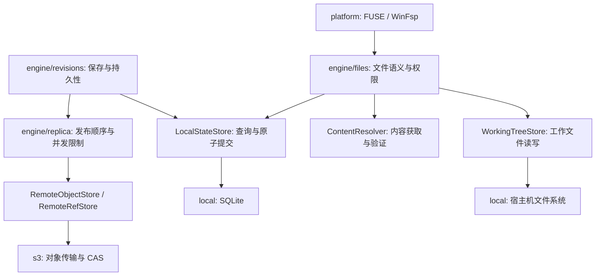

# 架构

[English](architecture.md) | [简体中文](architecture.zh-CN.md)

`agentdrived` 负责组装应用：创建具体适配器，将其注入 engine，并通过生成的 `Services` 提供服务。engine 依赖 model、ports 和 config crate；持久化、原生驱动、S3 和协议依赖由适配器管理。

| Crate | 职责 |
| --- | --- |
| `agentdrive-model` | ID、路径、对象、版本、分支、挂载关联、操作、合并记录和错误 |
| `agentdrive-config` | 配置定义、默认值、校验、文件原子替换、管理员授权和运行时配置快照 |
| `agentdrive-ports` | 存储、文件系统、挂载、时钟、目录和应用接口 |
| `agentdrive-engine` | 文件行为，以及工作区、版本、挂载、同步、缓存、所有权和合并流程 |
| `agentdrive-local` | 进程锁定、SQLite 元数据、不可变对象、工作文件、租约和读取验证 |
| `agentdrive-s3` | 不可变对象的流式传输和引用的条件更新 |
| `agentdrive-platform` | FUSE/WinFsp 回调、受目录范围限制的主机目录访问和时钟 |
| `agentdrive-mcp` | 具有明确类型的工具、带身份验证的 HTTP 路由、Dashboard 与设置接口、客户端和 stdio 转发 |
| `agentdrive-test-support` | 可控时钟、挂载和存储测试替代对象、服务中断和确认丢失的故障注入 |
| `agentdrived` / `agentdrive` | 守护进程生命周期和命令行客户端 |

## 模块职责

| 模块 | 职责 |
| --- | --- |
| `engine/runtime` | 工作区授权、本地身份、修改顺序与共享运行状态 |
| `engine/files` | 文件操作、打开的句柄、权限与 generation 检查 |
| `engine/content`、`engine/trees` | 内容读取验证、不可变索引与关联对象遍历 |
| `engine/snapshots`、`engine/revisions` | 捕获工作内容、保存版本、创建分支与恢复内容 |
| `engine/workspaces` | 创建工作区、查询状态，以及主机目录的导入导出 |
| `engine/mounts` | 选择工作区在本机使用的分支、复用挂载关联、保存挂载文件、协调挂载切换 |
| `engine/replica`、`engine/ownership` | 同步任务、远程条件写入与写入所有权交接 |
| `engine/storage` | 历史内容补齐、远程引用复制与存储切换 |
| `engine/cache` | 预取、固定缓存，以及按照当前配置回收允许清理的内容 |
| `engine/merge` | 准备合并候选内容、编辑文件、解决冲突与应用结果 |
| `engine/operations` | 请求去重、操作进度与持久化结果记录 |
| `config/types` | 缓存与 S3 的配置类型及策略校验 |
| `config/file` | 配置文件结构、默认值、token 文件读取与初始化目录 |
| `config/store` | 校验候选配置、控制写入顺序、保存文件与发布 `ArcSwap` 快照 |
| `mcp/gateway`、`mcp/server` | 验证 HTTP 请求身份并调用应用接口 |
| `mcp/web`、`mcp/dashboard` | 工作区、生命周期、设置的 HTTP 接口与浏览器页面 |
| `apps/agentdrive/integration` | ACP、Codex app-server 事件转发与持久化生命周期 |
| `apps/agentdrived/main` | 创建适配器、运行 HTTP 服务和后台任务、正常关闭服务 |

`agentdrive-ports` 定义 engine 使用的接口，存储和平台适配器负责实现接口。配置模块依赖 model 中的数据类型，数据库、挂载、S3 和 HTTP 服务由 daemon 创建。daemon 将同一个 `LiveConfig` 传给 engine 和 HTTP 入口；`ConfigStore` 统一发布配置，使用配置的模块为每次操作取得完整快照。

## 文件操作接口与事务边界

| 接口或模块 | 负责内容 | 调用方应遵守的范围 |
| --- | --- | --- |
| `FileSystem` / `engine/files` | 权限、句柄、路径行为、容量检查、节点变化 | platform 仅转换操作系统请求和错误；不直接访问 SQLite 或决定 branch |
| `LocalStateStore` | 节点查询、工作树统计、版本检查与原子提交 | engine 提交 `LocalCommit`；不依赖 SQL、表名或触发器 |
| `WorkingTreeStore` | 本地可修改文件的创建、读取、写入、截断和删除 | 不决定配额、权限、revision 或远端持久性 |
| `ContentResolver` | 不可变对象读取、下载合并与校验 | 文件操作通过此接口读取内容，不直接访问 S3 |
| `SnapshotCapture` / `engine/revisions` | 捕获一致内容、保存 revision、建立同步任务 | `local_saved` 与 `remote_confirmed` 分别表达本地保存和远端确认 |
| `engine/replica` | 发布顺序、重试、对象上传并发限制 | 全部依赖对象成功后才能发布 BranchRef；S3 适配器不决定发布时机 |
| `RemoteObjectStore` / `RemoteRefStore` | 对象传输、完整性验证和条件更新 | 协议实现不修改 branch、挂载或本地工作树 |

`LocalStateStore::usage` 返回当前 branch 的节点数量和逻辑字节数。local 在修改节点的同一个 SQLite 事务内增量更新统计；事务回滚同时恢复统计。engine 负责将统计与 workspace 限额比较。这里的逻辑容量不包含历史对象、下载缓存和临时文件，也不代表宿主机剩余磁盘容量。

`children` 只查询直接子项，使用 `(branch, parent, path)` 索引；`subtree` 按规范化路径范围读取需要移动的节点。检查点捕获读取 `node_deltas`；需要完整工作树的操作和恢复继续使用 `nodes` 查询。create/unlink 提交目标与父目录变化；rename 提交移动的节点、目标替换及父目录变化。目录移动的成本随被移动节点数量增长。

SQLite 中的 `parent` 查询列和 `node_usage` 统计由 local 管理。旧数据库第一次打开时，在一个事务内补充查询列、回填父路径、建立统计与触发器。显示路径仍保存在 Node 中，查询键使用 Unicode 规范化与大小写折叠。原始节点数据与远端对象格式保持不变。升级后的数据库应由支持这些查询投影的版本管理；回退程序前恢复升级前的状态目录备份。

同一 branch 的文件操作与快照仍通过 branch 互斥锁协调。不要在适配器中额外实现文件版本规则，也不要绕过该锁修改工作文件。缓存未命中的内容读取和首次修改仍可能在持锁期间下载旧内容；本次优化没有改变这项行为。SQLite 仍使用单连接互斥访问。

对象上传在一个 `ReplicaService` 内共享四个传输许可，每个对象使用流式接口。失败会停止安排后续对象，并等待已经安排的传输完成清理、释放许可，并保留可重试的同步任务；调用方不会发布依赖不完整的 BranchRef。新增依赖和当前远端引用之外的对象继续执行完整性验证；当前远端 branch 引用保留的公共不可变子树可以直接复用。

## 配置生命周期

`ConfigStore::open` 读取并校验文件。`StartupConfig` 在服务创建时提供存储目录、挂载、连接与凭据配置。缓存策略、S3 连接和 HTTP Origin 允许列表由同一个 `ArcSwap<Snapshot>` 保存。缓存清理在操作期间保持同一份快照；HTTP 身份验证为每次请求取得当前快照。

daemon 每秒检查配置文件。Dashboard 保存与文件加载使用同一个 `ConfigStore` 和写入锁。保存时检查配置版本，在同目录写入并同步临时文件，替换配置文件，然后发布快照；Unix 还会同步目录。文件错误、无效内容以及启动配置变化都会保留当前有效配置，并提供错误信息。配置版本检查会拒绝过期的 API 保存请求及已经检测到的外部修改；外部编辑器不使用 daemon 的写入锁，建议通过原子替换文件提交修改。

设置管理权限由启动配置中的 `administrators` 决定，默认为 `["owner"]`，与工作区授权分别管理。设置接口不会读取或返回 token 内容。修改 HTTP 凭据、管理员、本地目录或监听地址需要重启。S3 设置通过 `ConfigApplier` 准备内容、保存配置，并在持有生命周期、发布和内容保护锁期间更换远程适配器。字段说明与 HTTP 接口见[配置说明](configuration.zh-CN.md)。

## 本地持久化

每个守护进程状态目录包含 `engine.lock`、`meta.db`、SQLite WAL 文件，以及 `objects/`、`staging/` 和 `working/`。进程锁定确保只有一个写入者。SQLite 使用 WAL 和 `synchronous=FULL`。修改数据库结构前会检查持久化格式版本，存储错误通过明确的错误类型返回。

两种存储模式均将 `meta.db` 和 WAL 文件保存在本地。S3 接收不可变对象，以及下文说明的控制记录和分支引用。拉取操作将已发布历史导入接收端的数据库；本机身份、分支选择、挂载关联、缓存保留设置和尚未完成的工作属于本地状态。缓存容量仅统计不可变对象文件。S3 模式使用 `cache.max_bytes`，自动计算 75% 的清理目标，并使用内部固定的 64 MiB 磁盘剩余空间阈值。本地模式完整保留历史内容。

object ID 使用 SHA-256 对域分隔标记、格式版本、对象类型和内容字节计算摘要。发布时验证摘要和大小，将临时文件同步到存储设备，以不可变名称发布文件并登记对象。Unix 会在发布后同步目录，Windows 使用 write-through 文件移动。元数据事务引用已经安装的不可变对象，读取租约保护打开的内容，使其不会被缓存回收。

`TreeRoot` 引用大小受限的目录和 inode 索引。每个索引页面最多包含 128 项，元数据对象上限为 2 MiB。文件内容使用大小受限的缓冲区进行流式处理。目录项名称使用 NFC 规范化，并通过 Unicode case folding 比较。跨平台名称检查会拒绝路径穿越、Windows 保留名称、末尾句点或空格，以及不兼容的字符。

每个 branch 通过互斥锁管理文件修改与内容捕获。`node_deltas` 在节点修改的同一个 SQLite 事务内记录每个路径首次修改前的值。捕获时，将变化的文件保存为完整不可变文件对象，并更新受影响的 inode 和目录索引页面。branch 根对象、保存序号、节点内容及日志清理在同一个事务中提交，旧根对象保持可读。

文件系统 `fsync` 保存工作检查点，不创建 revision。本地检查点无需创建 operation 或同步任务；没有变化时，本地 fsync 直接返回。远端 fsync 额外发布工作根对象并等待远端确认，它拥有 operation 记录，中间检查点不会逐个保留为历史版本。自动保存仍按五秒无新写入、三十秒持续写入的期限创建 revision，daemon 每秒检查。显式 `mount_save`、`revision_commit`、创建 branch 和交接 branch 会按需要保存版本。检查点不会重置自动保存期限；重启恢复最新检查点后，尚未形成版本的内容会继续安排自动保存。

`branch_history` 保存最新不可变历史索引的引用，用于增量更新；已有数据库缺少该记录时，在创建下一项同步任务时重建。`object_usage` 保存已确认缓存与未确认对象的字节计数，由 SQLite trigger 在对象新增、删除及远端确认时同步更新。`LocalObjectStore::volume_stats` 为文件系统 STATFS 提供宿主磁盘容量，无需扫描对象记录。缓存回收在持有对象保护锁、检查活动读取者后，可以移除 branch、同步队列、保留版本和 pin 均未引用的未确认对象。持久化继续使用 SQLite 和完整文件对象。本地保留的 branch 会保留最新历史索引的全部页面，保证远端不可用时仍能增量保存。此规则仅保留索引页面，历史文件内容仍按正常缓存策略回收。

生命周期控制依次执行挂载变更、恢复、合并应用、所有权交接和取消操作。文件句柄携带挂载和分支的 generation，generation 变化后会拒绝旧句柄。一个挂载路径只能有一个活动关联，一个分支最多具有一个可写挂载。

每个状态目录持久保存一个 `location_id`，因此 `workspace_selections(workspace, branch)` 表示当前 location 对每个工作区的分支选择。创建工作区时选择根分支。其他 location 首次可写挂载时，从 `Workspace.initial_revision` 对应根分支的最新发布工作根对象创建自有分支，并在同一个事务中保存分支和选择。重复连接、卸载、更改挂载路径和重启均复用这份选择；`branch_switch` 显式修改选择。同一个 principal 的匹配请求共用现有挂载关联，Agent 连接结束后仍保留该关联。

使用远端 fsync 前，共享 workspace 的所有 location 应升级到支持工作检查点的版本。对象编码继续使用 format 1，但已发布的工作根对象可能与两个 revision head 均不同；旧客户端可能拒绝该状态或从较早版本创建 branch。升级前备份状态目录，本地回退时使用匹配的升级前备份。

## 同步与所有权

工作区由不可变对象、通过条件写入更新的工作区控制记录和分支引用组成。分支引用包含 owner、epoch、generation、source generation、head 和不可变历史索引。历史索引记录版本和操作结果。

连续的同步任务只有在 branch、owner、authority epoch 和 generation 相同、source generation 连续、durable sequence 不减少时才能合并。停止、删除、generation 变化或所有权变化会结束当前任务组。发布前验证最新历史索引保留了每项 operation 的身份和原始结果，然后比较远端当前引用与最新对象树，只上传新增依赖。最新 branch 引用通过条件写入确认后，所有相关结果确认和队列清理在一个 SQLite 事务中提交。每个 workspace 按顺序发布，不同 workspace 的请求可以并行，共享四个上传许可；更换存储需要取得独占发布锁。发布确认与挂载完成更新操作记录时，会在事务内检查原记录是否发生变化；并发修改触发重新读取和重试，从而保留远端确认与挂载状态。清理远端保留记录期间，已确认操作继续返回持久保存的完成进度。

`OperationRecord.sync_progress` 提供队列位置、发布阶段及对象和字节计数。`mount_save` 可以限制远端等待时间，返回持久化结果后继续发布。文件系统的远端 fsync 仍然需要完成确认才能成功返回。

发布时先上传全部被引用的对象，再对分支引用执行 compare-and-swap。条件写入使用存储提供程序返回的不透明版本值。确认丢失时，发布程序检查原始操作的历史记录。本地持久化任务支持重试和进程重启。工作区控制记录保护发布或读取过程中使用的根对象，并协调 GC 阶段。远端物理删除已禁用。

拉取会导入远端历史和引用，并保留活动本地分支的状态。接管已有分支需要经过确认的所有权交接。交接时停止旧写入者，完成其发布队列，然后通过条件写入更新 owner 和 epoch。新的 location 接管已确认状态。该 API 无法强制替换无法联系的 owner。

## 合并

合并准备会选择共同祖先，或检查调用者指定的祖先，然后比较路径变化并生成不可变候选内容。AI 可以查询候选版本的文件列表，选择 source、target，删除文件，提交替换内容，或从已有版本复制文件。编辑会生成新的候选版本。应用要求目标分支没有未提交内容、所有权与版本匹配、全部冲突已处理，并且挂载允许切换。合并版本保留来源与目标两个父版本。

## 身份验证边界

创建 MCP 服务前，bearer 凭据会选择 principal。每项凭据拥有独立的 HTTP 会话管理器，工具参数无法覆盖 principal。HTTP 入口使用 Host 和 Origin 允许列表，并将请求正文限制为 8 MiB。守护进程监听本机回环地址。远程访问需要管理员管理的身份验证 TLS 代理，并保留允许的 Host 值。

工作区授权控制应用操作。原生文件系统访问使用守护进程的操作系统身份。配置、凭据、状态、挂载根目录和交换根目录应限制为该身份访问；Windows 需要相应配置 NTFS 权限。S3 凭据持有者和管理员被视为可信的存储写入者。

参见[配置与 S3](configuration.zh-CN.md)、[CLI 使用](cli.zh-CN.md)和 [MCP 参数与能力](mcp.zh-CN.md)。
